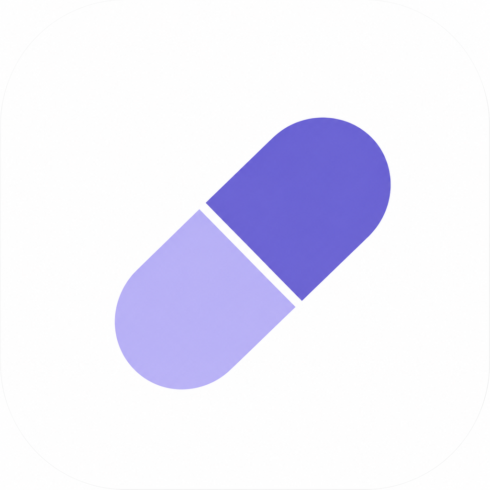

<p align="center">
  
</p>

<h1 align="center">PillBuddy</h1>
<p align="center"><b>Your medication buddy: scan it, check it, take it right.</b></p>
<p align="center">HackGT 13 · Prathithi · Anushka · Aditi · Gargi</p>

---

PillBuddy makes sure the pill in your hand is the right one, at the right time. Scan a pill bottle once, and from then on the app checks you're holding the right bottle in AR before you log a dose, blocks doses taken too close together, identifies a dropped pill, and can call or message your provider's office for refills.

## What it does

### ✅ Verify
| Feature | What it does | Built with |
|---|---|---|
| Bottle scanning | Reads CVS prescription and Nature Made labels: drug, strength, quantity, directions, expiration | AVFoundation, Vision |
| AR bottle check | Green card over the right bottle, red over wrong ones, before you can log a dose | ARKit, RealityKit, Vision |
| Pill identification | Matches a loose pill's shape, color, and imprint to your own medications | Vision, Core Image, NLM Pillbox data |
| Overdose prevention | Blocks doses taken too soon or over the daily limit, even if logged on another device | Swift, Tiger Data |

### 🌐 Understand
| Feature | What it does | Built with |
|---|---|---|
| Listen | Reads each medication's label information aloud | AVSpeechSynthesizer |
| Translate | Translates it on-device into Spanish, Chinese, Hindi, French, Korean, or Arabic | Apple Translation |

### 🕒 Stay on track
| Feature | What it does | Built with |
|---|---|---|
| Reminders & schedule | Turns label directions into dose times and reminders | SwiftData, UserNotifications |
| Streaks & adherence | Streaks, a calendar, and a 7-day chart read from the cloud | SwiftUI, Swift Charts, Tiger Data |
| AI assistant | Answers medication questions and decides when to contact your provider | Google Gemini, OpenAI Whisper |
| Provider calls | Calls the office, records the answer, falls back to WhatsApp | Twilio, Whisper, Gemini, WhatsApp Cloud API |

## How it works

```
iPhone app (SwiftData, works offline)
   │  doses and bottles, queued and retried
   ▼
FastAPI server on Vultr
   │
   ▼
Tiger Data (TimescaleDB)
   prescriptions        one row per bottle
   dose_events          hypertable: every dose logged
   check_dose()         overdose check across all devices
   adherence_summary()  doses taken vs. expected per day (time_bucket)
```

- **Label reading:** Vision reads the label several times a second, and a value only counts once two frames agree, since a curved bottle never shows the whole label at once.
- **AR check:** each bottle is recognized by its label, placed in 3D with ARKit, and tagged green or red. Cards follow the bottles and disappear when a bottle is moved away.
- **Pill identification:** Vision cuts the pill out of the image; its outline gives the shape, its average color the color, and text recognition the imprint. It's matched only against your own medications (imprint 60%, color 25%, shape 15%).
- **Cloud:** every dose is stored in a Tiger Data hypertable through an API on Vultr. The phone keeps working offline and syncs later.

## Repository layout

```
Pill App/               iOS app (SwiftUI, iOS 18+) and Xcode project
pill-api/               Server code deployed on Vultr
main.py                 FastAPI API: syncs doses to Tiger Data, overdose check, adherence
server.js               Node voice server
schema.sql              Tiger Data tables and SQL functions
Sources/, Tests/,       MedBot: the Gemini chatbot and provider-call engine
Package.swift           (Swift package; also runs as a Mac app and command-line tool)
```

## Setup

**Database (Tiger Data)**
1. Create a Tiger Cloud service and run `schema.sql` in its SQL editor.

**Server (Vultr)**
1. Copy the server code to a Vultr instance and install dependencies (`pip install -r requirements.txt`, `npm install`).
2. Create a `.env` with `DATABASE_URL` (Tiger connection string) and `API_KEY`.
3. Run the API with `uvicorn main:app` behind HTTPS.

**iOS app**
1. Create `Secrets.plist` in the Xcode project with your API keys (Gemini, OpenAI, Twilio, WhatsApp, and `PILL_API_URL` / `PILL_API_KEY`).
2. Open the project in Xcode and run on a real iPhone. Camera, AR, and Vision features don't work in the Simulator.

## Privacy

- The cloud stores a random ID per install, never a name.
- Dose reminders don't name the medication on the lock screen.
- Rx numbers are only used as database keys and are never read aloud.
- WhatsApp messages are shown to you before anything is sent.
- Translation and text recognition run on the device.
- API keys live in `Secrets.plist` / `.env`, which are not committed.

## Team

| Name | Role |
|---|---|
| Prathithi | Pill identification, AR bottle check, app design |
| Anushka | MedBot AI assistant and provider calls |
| Aditi | Bottle label scanning and dose logging |
| Gargi | Cloud backend (Vultr, Tiger Data) |

## Acknowledgments

- Pill appearance data from the U.S. National Library of Medicine's Pillbox archive.
- Built at HackGT 13 with help from Claude (Anthropic).
